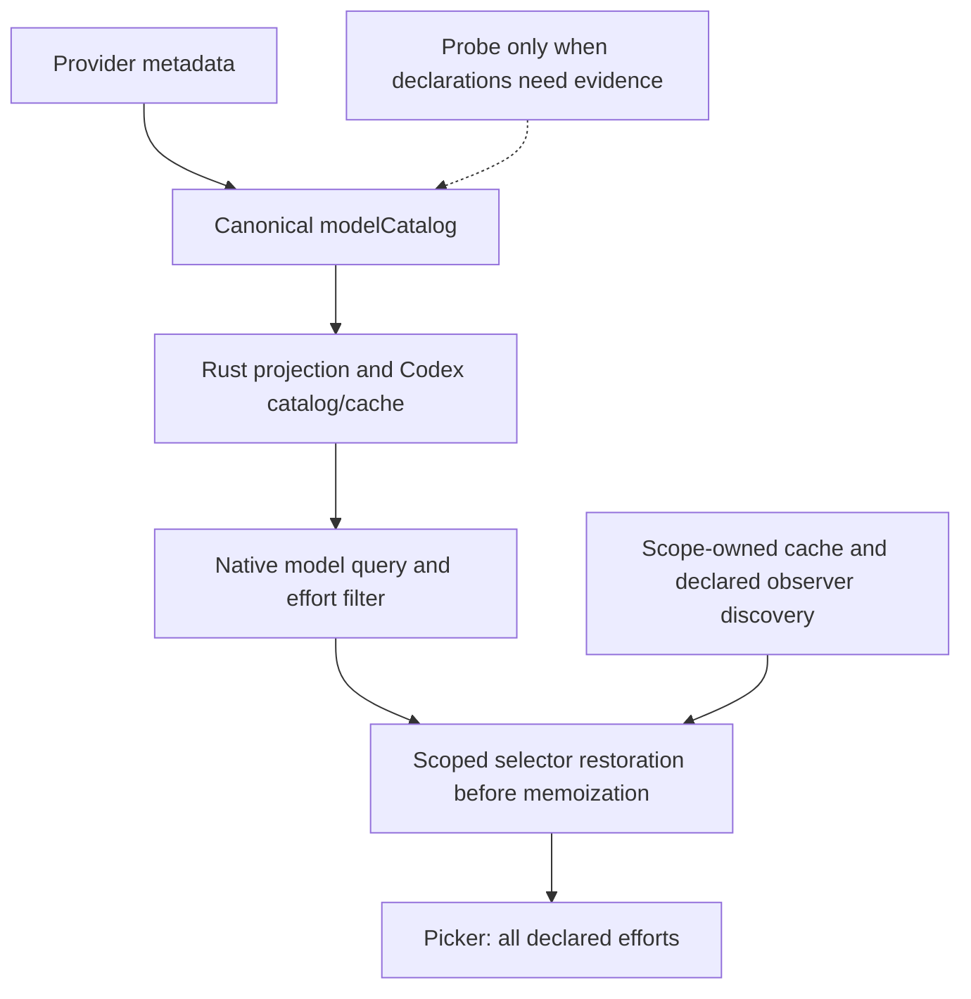

# Codex Picker Effort Audit, 2026-10-17

## Scope And Evidence

This follow-up addresses missing `max`/`ultra` in managed Codex Desktop model
pickers and extracts Desktop JavaScript from Rust string literals. The previous
metadata/protocol work addressed catalog declarations and provider readiness;
it did not cover every renderer query-reader lifecycle.

Read-only inspection of installed package
`OpenAI.Codex_26.1013.4894.0_x64__2p2nqsd0c76g0` established:

- The native selector in `app-initial-5851df3f6cb1.js` filters advertised efforts
  through enabled effort preferences and its Ultra feature flag.
- Default enabled preferences in `app-shared-bbfeca5e5737.js` omit `max`.
  The per-model picker recognizes `max`; there is no universal `xhigh` ceiling.
- The installed query key has both forms: custom-provider queries append the
  provider, while the current local Desktop path can use the provider-less
  `["models", "list", "local", auth, limit]` key. The selected
  `{ models, defaultModel, ... }` shape remains the projection contract; raw
  `{ data }` outputs are intentionally left untouched.
- Query signals construct an observer and compute optimistic/current snapshots
  before subscribing. Some snapshot readers remain unsubscribed.
- The request registry is private in the current package, while QueryObserver
  is exported. Cache discovery must not depend on an exported request registry.

The active model's local projected catalog and models cache both contained
`low`, `medium`, `high`, `xhigh`, `max`, and `ultra`. This is local artifact
evidence, not a fresh provider `/models` response or a live renderer result.

## Source Defects And Corrections

1. Cache discovery returned early when the request registry was not exported.
   It now finds the declared renderer scope and its query client independently.
   Exported observer prototypes are identified by declared methods, not minified
   export names, and unrelated getters/RPC proxies are not invoked.
2. The previous restoration wrapped only subscribed observers. A real TanStack
   regression reproduced an unsubscribed snapshot stopping at `xhigh`.
   The shared `createResult` boundary now projects selector options before
   TanStack memoization, including constructor and optimistic snapshot reads.
3. Restoration is limited to exact Query instances in registered caches, local
   managed provider keys, and enabled rows in the current canonical catalog.
   Copied owned selectors are unwrapped before evaluating a different scope.
   Provider-appended and provider-less local query keys are both accepted;
   empty declarations remain empty; foreign caches and remote hosts stay native.
4. Prototype and instance hooks retain ownership information for reversible
   cleanup. Reinjection replaces owned hooks without nesting legacy wrappers;
   catalog release restores the native prototype and prevents reinstallation.

There is no new persisted capability store and no hardcoded model-name fix.
The current catalog remains the authority for every managed model's effort list.
The request-client registry itself still uses its existing discovery fallbacks;
this change removes that dependency from reasoning-cache discovery.

## Runtime Resources

All thirteen Desktop runtime fragments, including the large installation
template, live under `src-tauri/src/resources/codex_desktop/`. Rust assembles them
with `include_str!`; files are ordinary parseable JavaScript with explicit slots.
Catalog JSON is inserted last so model metadata cannot be interpreted as another
template replacement. Regression tests cover fragment/assembled syntax, complete
slot resolution, and literal metadata containing slot names and braces.

The normal format gate includes these resources. The renderer runtime identity
is a SHA-256 fingerprint of the assembled runtime template, including fragment
order, slot wiring, and generated prompt content. Rebuilt integrations
automatically invalidate owned hooks; no manual revision bump is required.

## Repair Warning Follow-Up

The screenshot records a repair attempt on October 17, 2026 at approximately
15:25 Singapore time. That attempt predates the inspected CCSwitch process
(15:34) and Codex shell process (15:38).

The current shell has a debug listener on port `9229`. Its CDP page is
`app://-/index.html`, titled with the current task rather than "Codex". The old
target matcher rejected it despite the available debug port. The matcher now
accepts that packaged URL only when the actual listener belongs to a verified
Codex Desktop shell. An unverified or mixed-owner listener fails closed;
unrelated Electron pages and web pages remain ineligible. Failure text also
distinguishes a detected CDP target from a missing injectable port.
The final read-only ownership check found the sole loopback listener on `9229`
owned by PID `56724`, the official Codex MSIX `ChatGPT.exe` shell, not a
Chromium child process.

Earlier Codex logs, around 15:22-15:24, show a separate failure: the official
model-list request returned `401`, and the fallback cache contained a
`gpt-6-astra` row without either required instruction source. The current
catalog/cache are valid, but a legacy official backup still lacked those fields.
Official source normalization now backfills parser-required data before reuse.
Initial backup creation, repeated synchronization, and direct legacy restoration
also cover this contract. Valid backup bytes, native metadata, and declared
efforts remain unchanged. The cache fix does not repair an expired OpenAI token
or change the selected provider.

## Configuration Ownership

- `~/.cc-switch/cc-switch.db` stores provider catalogs and router/profile state.
  The canonical provider field remains `modelCatalog`.
- `~/.cc-switch/settings.json` holds machine-local application preferences.
- `~/.codex/config.toml` selects the current provider, model, default effort,
  and generated `model_catalog_json`.
- `~/.codex/cc-switch-model-catalog.json` and `models_cache.json` are derived
  Codex-facing projections, not independent capability sources.
- The Desktop renderer compatibility layer is runtime state. It must be
  reinjected by the rebuilt CCSwitch integration after a renderer reload.

The inspected default effort is `xhigh`; this chooses the default and does not
limit the catalog's available levels. Source/resource edits do not update an
already-running native executable.

The running repository debug executable was last built at 15:34:40, before the
follow-up Rust fixes. The normal `pnpm dev` supervisor waits for a four-hour
backend quiet period. `pnpm dev:immediate` rebuilds backend changes immediately.
Extracted JavaScript still enters the native binary through `include_str!`;
frontend hot reload or `build:renderer` alone cannot deploy that runtime code.

## Provider Model Metadata Follow-Up

A scoped read-only request to the active local router's `/v1/models` returned
HTTP `200`, 36 rich `models` entries, and 36 generic compatibility `data` entries.
The rich branch preserves reasoning/default/protocol and picker metadata; the
generic branch is deliberately minimal. This is the active included router
catalog, not the union of every saved provider.

Current routed OpenRouter/external rows are visible in the rich catalog.
Sublyx GPT rows retain `max`; `ultra` is present only where explicitly declared.
In particular, the inspected Luna rows stop at `max`, while Sol/Astra rows that
declare `ultra` retain it. No universal GPT effort ceiling is inferred.

Source re-verification also found a discovery-base mismatch: successful
OpenRouter discovery at `/api/v1/models` did not receive OpenRouter-specific
reasoning/protocol parsing when the configured base was `/api`. A recognized
`/api` or `/api/v1` base and the resolved same-origin model-list endpoint now
identify that provider contract together. Arbitrary same-origin paths and
generic providers do not inherit OpenRouter's effort enum or protocol defaults.
Existing tests retain explicit false/empty declarations and reject conflicting,
malformed, credential-bearing, cross-origin, and lookalike-provider metadata.

## Verification Boundary

No configured background live picker monitor was available. The follow-up
checked only scoped application processes, configured logs, local artifacts,
CDP target listings, and the active local router endpoint. It did not drive
the workspace UI, inject a new script, or issue paid model/probe requests.

The local endpoint check is not a fresh request to every upstream provider and
does not prove the current visible picker received the new runtime. Source
tests and renderer builds likewise do not establish that the native CCSwitch
executable was rebuilt/restarted or a production artifact installed.

## Source Verification

- `pnpm typecheck`, `pnpm catalog:verify`, and `pnpm format:check` passed.
- `pnpm test:unit`: 258 files, 2,417 tests passed.
- `pnpm build:renderer` passed its catalog gates and production renderer build.
- Combined Rust Codex, model-fetch, and provider-metadata scopes: 581 passed,
  zero failed, zero ignored.
- The explicit `codex_multirouter::` scope passed 153 tests; the Desktop scope
  passed 99 tests.
- `cargo fmt --check --manifest-path src-tauri/Cargo.toml`,
  `cargo clippy --manifest-path src-tauri/Cargo.toml -- -D warnings`, and
  `git diff --check` passed.

The two new first-backup/direct-restore regressions reproduced the old failures
before the cache fix. Existing exact backup and empty-catalog assertions remain;
three existing restoration fixtures now provide schema-valid official rows
instead of expecting an invalid cache to be preserved.
