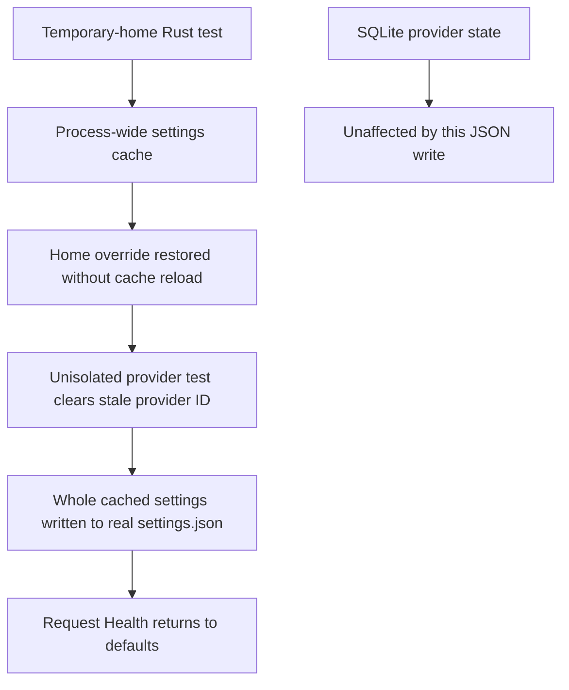

# Request Health Persistence Audit, 2026-10-17

## Observed State

The scoped read-only inspection found valid JSON at
`C:\Users\Felix\.cc-switch\settings.json`. Request Health was enabled with its
complete default configuration. The file was last written at 19:07:31 Singapore
time, substantially after the running debug application's 15:34:40 start.
The configured application logs contained no settings parse or save failure.
They do not identify every successful settings writer, so they cannot establish
which caller caused the historical reset or prove that a prior disable reached
disk. No settings backup was found immediately in that configuration directory.

Provider catalogs and profiles use `cc-switch.db`. Device preferences, including
Request Health, deliberately use `settings.json` outside database sync. Different
storage ownership explains why provider data can survive an application-settings
overwrite; it does not establish a SQLite reliability problem.

## Defects

1. The Request Health master switch changed only the panel draft until its
   explicit Save button was used. Other General switches save immediately.
2. A successful dedicated Request Health save updated local form state without
   acknowledging the returned canonical value in the shared settings query.
   A failing pre-fix regression demonstrated that a subsequent General save sent
   `enabled=true` after Request Health had been saved as disabled. The current
   backend's dedicated-settings preservation already prevented that stale
   General payload from overwriting Request Health on disk.
3. A Rust provider regression test had no isolated home. It could indirectly
   persist settings through
   `ProviderService::update -> get_effective_current_provider ->
   set_current_provider(None)`. Other tests could leave the process-wide
   settings cache containing defaults after restoring their temporary-home
   override. The next unisolated writer could therefore persist the complete
   cached defaults to the real user settings file.
4. Automatic proxy repair, guardian startup, and warning synchronization could
   outlive temporary-home scopes and interact with the actual running Codex.
   File isolation alone does not isolate a local CDP port.

The third item is a concrete unsafe overwrite path selected by the previously
used Codex validation scope. It is a credible explanation of build-associated
resets, not a logged attribution of the historical write.



## Corrections

- The master switch uses a dedicated persisted `enabled` operation immediately.
  The backend changes only that field under the existing settings write lock and
  returns the complete canonical Request Health config.
- Full Request Health saves and master-switch saves share the General save
  queue. Successful saves cancel older settings reads and acknowledge only
  Request Health in the shared query cache, preserving unrelated form drafts.
- Failed master-switch saves roll back the visible switch. Numeric inputs and
  other edits remain explicit Save operations; invalid or in-flight drafts are
  not published by switching Request Health on or off.
- Unit-test home fallback is always temporary, including the legacy Windows
  `HOME` compatibility path. A reusable serialized home guard reloads the
  settings cache on both entry and restoration. The concrete provider test now
  uses that guard.
- One policy suppresses automatic Desktop/CDP work in unit-test binaries and
  instances with a nonblank `CC_SWITCH_TEST_HOME`. This also covers integration
  tests, whose linked library does not have `cfg(test)`. Normal production
  instances and explicit manual unlock behavior are unchanged.

There is no new settings store or database migration. The existing JSON file
remains canonical and is still written atomically.

## Regression Evidence

- The stale-cache frontend regression failed before the acknowledgment fix.
- A callback-only warning-dispatch regression failed before the isolation
  policy was added, without starting real external work.
- Backend coverage exercises the real command, disk readback, settings reload,
  unrelated writes, stale General saves, custom options, notification snooze,
  disabled full saves, and re-enable without replacing other values.
- Isolation tests cover absent and blank home overrides, explicit home
  precedence, nested cache restoration, and unit/integration policy branches.

## Verification

- `pnpm typecheck`, `pnpm catalog:verify`, and `pnpm format:check` passed.
- `pnpm test:unit`: 258 files and 2,417 tests passed.
- The relevant Rust settings, configuration, proxy, provider-preflight, and
  Desktop scope passed the focused and broader Rust gates; the Desktop scope
  passed 99 tests. The separate required `codex_multirouter::` scope passed
  153 tests.
- `cargo fmt --check --manifest-path src-tauri/Cargo.toml` and
  `cargo clippy --manifest-path src-tauri/Cargo.toml -- -D warnings` passed.
- `pnpm build:renderer` passed its catalog gates and renderer build.
- The real user settings file's checksum and 19:07:31 modification timestamp
  were unchanged across the fixed unit-test verification.
- `git diff --check` passed.

The additional native integration check was attempted with this exact command:

```text
cargo test --manifest-path src-tauri/Cargo.toml --test profile_roundtrip --test provider_service -- codex_profile_reapplies_same_multirouter_after_takeover_cleanup codex_official_to_deepseek_then_takeover_enters_and_restores_proxy_managed_live_config --exact --test-threads=1
```

Cargo could not remove the running
`H:\repos\ccswitchmulti-refork\src-tauri\target\debug\cc-switch.exe`:
`Access is denied. (os error 5)`. Neither selected integration case executed.
The application was not stopped to force that check through.

## Activation Boundary

Source checks and renderer builds do not update an already-running native
application. The backend command, test safety policy, and embedded Desktop
resources require a native rebuild and restart. No live settings were edited
to invent or restore lost historical values, and no Codex UI/CDP injection was
performed during this follow-up.
